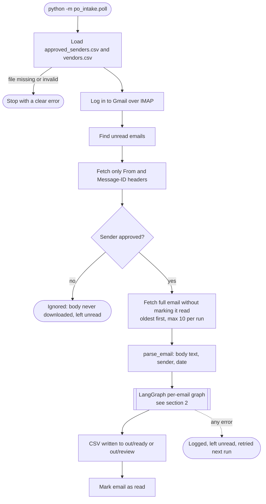
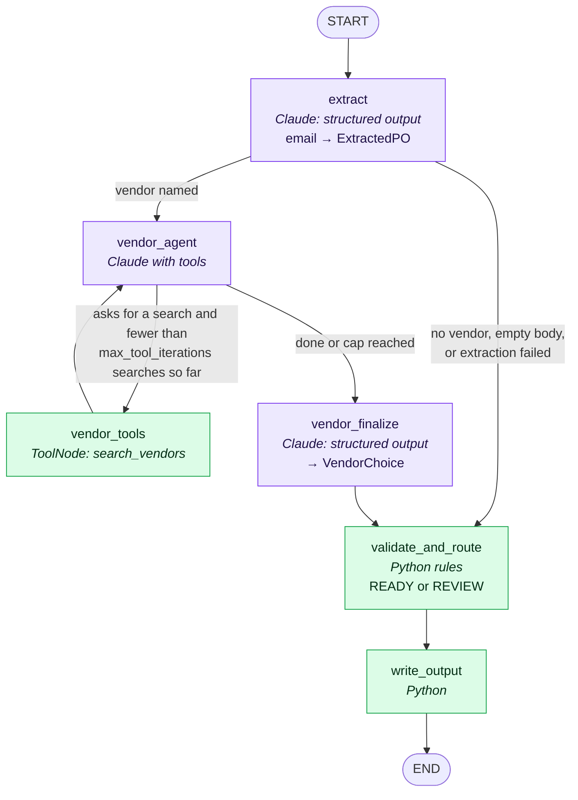

# PO Email Intake: Architecture

Turns purchase-request emails into PO CSV files.
**Claude reads, Python decides:** the model never approves a PO, picks a vendor ID, or writes a file.

## 1. End-to-end flow

## 2. Per-email graph (LangGraph)

Purple = Claude. Green = plain Python. The two places with a choice (after `extract` and after `vendor_agent`) are LangGraph conditional edges.

- The search loop runs at most `max_tool_iterations` times (3 in `config.yaml`); after that, `vendor_finalize` runs even if Claude still wants to search.
- `validate_and_route` uses the vendor name from `vendor_finalize` only if that name appears in the email; otherwise it falls back to the name from `extract`.

## 3. What validate_and_route checks

| Check | Issue if it fails |
|---|---|
| Vendor named and exactly in vendors.csv (typos count as missing) | VENDOR_NOT_STATED / VENDOR_AMBIGUOUS |
| Ship-to present | SHIP_TO_MISSING |
| At least one line; each has description, quantity, unit, price, date, cost center | NO_LINES / LINE_FIELD_MISSING |
| Numbers positive and valid, date is YYYY-MM-DD | INVALID_NUMBER / INVALID_DATE |
| Email states the PO total and it equals the sum of the lines | TOTAL_NOT_STATED / TOTAL_MISMATCH |
| Nothing unclear (tax, shipping, options, other currency) | AMBIGUOUS_REQUEST |

Any issue → **REVIEW**. No issues → **READY**, with approval **Pending** if the total is over $1000.00, otherwise **Passed**.

## 4. Code map

| File | Role |
|---|---|
| `poll.py` | Gmail pass: sender check, fetch, run graph, mark read |
| `emailparse.py` | `parse_email`, shared by the poller and the sample runner |
| `refdata.py` | Load the two CSVs; exact sender check |
| `graph.py` | The LangGraph graph above |
| `extract.py` | Claude prompt for reading the email |
| `vendor_agent.py`, `vendor_tool.py` | Vendor loop prompts and the `search_vendors` tool |
| `rules.py`, `normalize.py` | All business rules, in plain Python |
| `output.py` | Ready and review CSV writers |
| `samples.py` | Runs the 14 sample emails and compares with expected results |
| `config.yaml` | Every tunable value; secrets live in `.env` |
